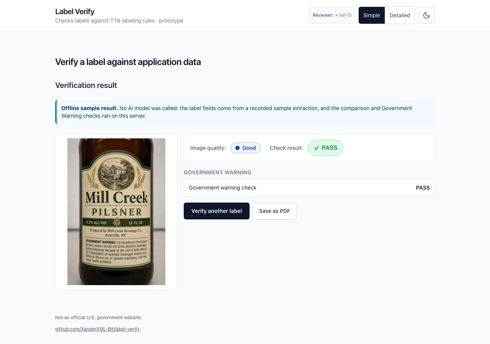

# Label Verify

[](https://github.com/XanderXML-Bit/label-verify/actions/workflows/ci.yml)
[](https://github.com/XanderXML-Bit/label-verify/actions/workflows/post-deploy-smoke.yml)

> Independent prototype that checks labels against TTB labeling rules. Label Verify compares beverage labels with Certificate of Label Approval (COLA) application data. The public demo runs three bundled samples without model calls or file uploads.

[Open the demo](https://label-verify-six.vercel.app) and choose the Pass, Fail, or Review sample to see the evidence behind its verdict.



## What it does

- Compares label text with the declared brand, class, alcohol content, net contents, producer, and country of origin.
- Checks the Government Warning for required text, capitalization, bold type, and minimum size.
- Returns Pass, Fail, or Review with reasons by field. Review flags evidence that needs a human check.
- Accepts single or batch uploads in self-hosted live-model mode. Batch input can pair files by filename or read declared data from a manifest.

## How it works

The demo takes a sample ID and looks up its recorded extraction. The self-hosted pipeline uses a vision model to extract fields and optical character recognition (OCR) to help measure warning text. Both modes run the extracted fields through the same application-data comparators and warning checks.

## Results

A recorded live-model cross-pair benchmark evaluated 170 synthetic and AI-generated labels against correct and deliberately altered application data.

| Application data | What counts toward the rate | Result | Review verdicts | Excluded errors |
| --- | --- | ---: | ---: | ---: |
| Correct | Verdict matched the expected Pass or Fail | 119/169 (70.41%) | 47 | 1 |
| Deliberately altered | Verdict was Fail or Review | 169/169 (100%) | 0 | 1 |

Three labels expected to fail received Pass verdicts with correct application data. They were `deg-beer-0012.png`, `syn-beer-0016.png`, and `syn-spirits-0013.png`. See the [false-pass cases](benchmarks/README.md#review-recorded-false-passes).

Both excluded rows are for `ai-label-0048.jpg`. Its ground truth lacked the required net contents, so neither pairing reached the verifier. See the [recorded run](benchmarks/results/wave35-supplemental-crops/baseline-run1.json), [benchmark protocol](docs/BENCH-PROTOCOL.md), and [model selection](docs/MODEL-SELECTION.md).

## Run it locally

```bash
# Prereqs: Node.js ≥ 22.12.0, git
git clone https://github.com/XanderXML-Bit/label-verify.git
cd label-verify
```

On macOS and Linux, install from the lockfile and start the development server.

```bash
npm ci
npm run dev
```

Open [localhost:3000](http://localhost:3000) and choose a sample. The default setup uses the recorded samples. Follow the [deployment guide](docs/DEPLOYMENT.md) to enable live models and uploads.

## Tests

```bash
npm run typecheck
npm run lint -- --max-warnings=0
npm run verify:claims
npm test
npm run build
```

Vitest covers the field comparators, warning validator, API routes, and browser components. The claims check compares selected documentation claims with code and stored results. Run the [Tesseract-only benchmark](benchmarks/README.md) to check the OCR baseline without a model API key:

```bash
npm run bench:routine -- --corpus test-data-v2 --technique T1
```

## Architecture

Label Verify uses Next.js App Router, React, TypeScript, and Tailwind CSS. It uses sharp for image preprocessing and Tesseract.js for OCR.

| Area | Entry point |
| --- | --- |
| Upload and sample UI | [Page](src/app/page.tsx) |
| HTTP interface | [OpenAPI specification](docs/openapi.yaml) |
| Verification pipeline | [Verifier](src/lib/verify.ts) |
| Benchmarks and fixtures | [Benchmark runner](benchmarks/run.ts) and [corpus map](docs/CORPORA.md) |

See the [architecture guide](docs/ARCHITECTURE.md), [CLI reference](docs/CLI.md), and [security policy](SECURITY.md) for implementation details.

## Limitations

The benchmark uses generated labels. Its scores do not estimate performance on submitted COLA applications. Image blur, glare, and occlusion can require manual review. Label Verify covers a subset of labeling rules, and reviewers make the final compliance decision.

## License

The repository has no `LICENSE` file.
